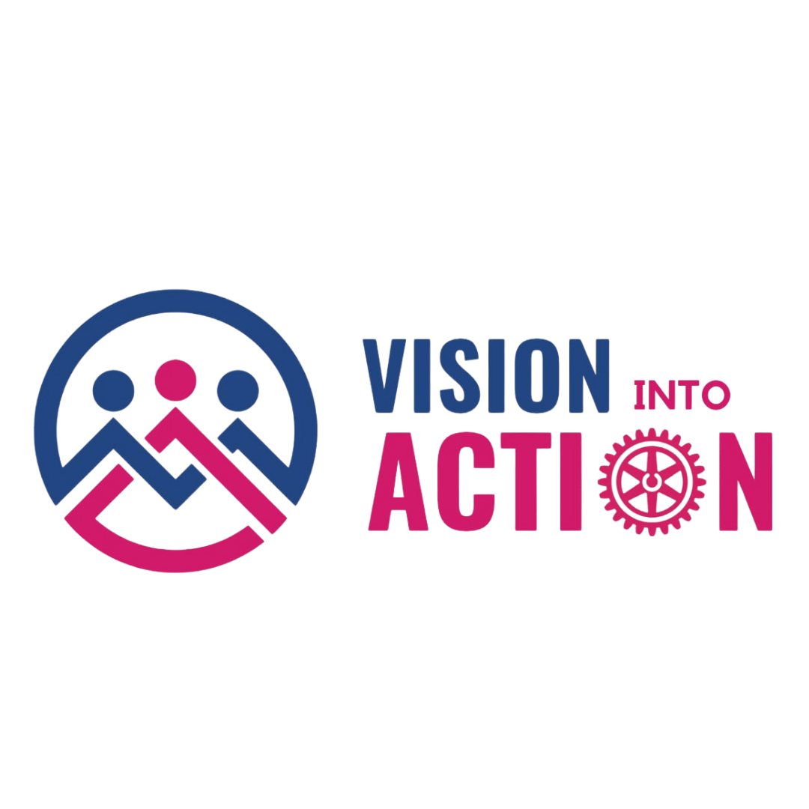

<div align="center">
  

  # Rotaract Club of Butwal Synergy

  **Empowering Youth. Inspiring Leadership. Creating Impact.**
</div>


## Who We Are

The **Rotaract Club of Butwal Synergy** is a youth-led service organization dedicated to developing young leaders, building lasting friendships, and creating meaningful change in society.

Our club brings together passionate young people who share a commitment to leadership, professional development, community service, and humanitarian action. Through service projects, collaborative programs, and fellowship, we empower youth to address community needs and build a better future.

We are proudly sponsored by the **Rotary Club of Butwal Downtown** and are part of **Zone 19, Rotary International District 3292, Nepal and Bhutan**.

## Club Information

| | |
|---|---|
| **Club Name** | Rotaract Club of Butwal Synergy |
| **Club ID** | 215519 |
| **Sponsoring Rotary Club** | Rotary Club of Butwal Downtown |
| **Zone** | Zone 19 |
| **Rotary District** | RID 3292 |
| **Region** | Nepal & Bhutan |

## Our Mission

To provide opportunities for young people to enhance their leadership and professional skills, develop lasting friendships, and address the needs of their communities through meaningful service initiatives.

## Our Vision

To inspire a generation of responsible, compassionate, and empowered young leaders who strengthen communities, promote global understanding, and create sustainable positive change.

## What We Do

- Serve and support our local community
- Develop leadership and professional skills
- Organize impactful events and projects
- Build friendship, fellowship, and collaboration
- Connect young leaders with Rotary’s global movement

## About This Website

This website shares our club’s story, team, past leaders, events, projects, and community impact.

Event, team, and leader information can be updated in:

```text
edit/site-content.ts
```

---

<div align="center">
  <strong>Together We Lead. Together We Serve. Together We Make a Difference.</strong>

  <br /><br />

  Made with ❤️ by <strong>Nirmal</strong>.
</div>
